<div align="center">

# ⚔️ [ SYSTEM NOTIFICATION ] ⚔️
### **YOU HAVE BEEN CHOSEN AS A PLAYER**

<p>
  
</p>

</div>

---

<!-- AWAKEN:START -->
<!-- Generated by git-profile-awaken. Edit awaken.json instead of this block. -->
<p align="center">
<picture><source media="(prefers-color-scheme: dark)" srcset="awaken/levelup-dark.svg"><source media="(prefers-color-scheme: light)" srcset="awaken/levelup-light.svg"></picture>
</p>

<p align="center">
<picture><source media="(prefers-color-scheme: dark)" srcset="awaken/hunter-dark.svg"><source media="(prefers-color-scheme: light)" srcset="awaken/hunter-light.svg"></picture>
</p>

<p align="center">
<picture><source media="(prefers-color-scheme: dark)" srcset="awaken/ladder-dark.svg"><source media="(prefers-color-scheme: light)" srcset="awaken/ladder-light.svg"></picture>
</p>

<p align="center">
<picture><source media="(prefers-color-scheme: dark)" srcset="awaken/web-dark.svg"><source media="(prefers-color-scheme: light)" srcset="awaken/web-light.svg"></picture>
<picture><source media="(prefers-color-scheme: dark)" srcset="awaken/skills-dark.svg"><source media="(prefers-color-scheme: light)" srcset="awaken/skills-light.svg"></picture>
</p>

<p align="center">
<picture><source media="(prefers-color-scheme: dark)" srcset="awaken/activity-dark.svg"><source media="(prefers-color-scheme: light)" srcset="awaken/activity-light.svg"></picture>
</p>

<p align="center">
<picture><source media="(prefers-color-scheme: dark)" srcset="awaken/quest-dark.svg"><source media="(prefers-color-scheme: light)" srcset="awaken/quest-light.svg"></picture>
<picture><source media="(prefers-color-scheme: dark)" srcset="awaken/contribution-dark.svg"><source media="(prefers-color-scheme: light)" srcset="awaken/contribution-light.svg"></picture>
</p>

<p align="center">
<picture><source media="(prefers-color-scheme: dark)" srcset="awaken/oracle-dark.svg"><source media="(prefers-color-scheme: light)" srcset="awaken/oracle-light.svg"></picture>
<picture><source media="(prefers-color-scheme: dark)" srcset="awaken/daily-dark.svg"><source media="(prefers-color-scheme: light)" srcset="awaken/daily-light.svg"></picture>
</p>

<p align="center">
<picture><source media="(prefers-color-scheme: dark)" srcset="awaken/rune-str-dark.svg"><source media="(prefers-color-scheme: light)" srcset="awaken/rune-str-light.svg"></picture>
<picture><source media="(prefers-color-scheme: dark)" srcset="awaken/rune-agi-dark.svg"><source media="(prefers-color-scheme: light)" srcset="awaken/rune-agi-light.svg"></picture>
<picture><source media="(prefers-color-scheme: dark)" srcset="awaken/rune-int-dark.svg"><source media="(prefers-color-scheme: light)" srcset="awaken/rune-int-light.svg"></picture>
<picture><source media="(prefers-color-scheme: dark)" srcset="awaken/rune-vit-dark.svg"><source media="(prefers-color-scheme: light)" srcset="awaken/rune-vit-light.svg"></picture>
</p>

<p align="center">
<picture><source media="(prefers-color-scheme: dark)" srcset="awaken/rune-luk-dark.svg"><source media="(prefers-color-scheme: light)" srcset="awaken/rune-luk-light.svg"></picture>
<picture><source media="(prefers-color-scheme: dark)" srcset="awaken/rune-cha-dark.svg"><source media="(prefers-color-scheme: light)" srcset="awaken/rune-cha-light.svg"></picture>
</p>
<!-- AWAKEN:END -->

---

### 🛡️ Player Profile & Information

```yaml
Name: Trần Duy Trường
Alias: truong311203-arch
Class: AI & Software Engineer
Main Focus: Autonomous Agents, LLM Applications, Data Pipelines, Systems
Location: Vietnam (UTC+7)
Status: "Continuously training in dungeons and grinding knowledge"
```

---

### 🎒 Arsenal & Inventory (Tech Stack)

<div align="center">

| Category | Arsenal |
|:---|:---|
| **Core Languages** |     |
| **AI & Data Science** |     |
| **DevOps & Infrastructure** |     |

</div>

---

### 📜 Active Quests & Milestones

- [x] **Gate Opener:** Awaken GitHub Profile into a LitRPG System window.
- [ ] **Shadow Extraction:** Complete 365 days of code contributions without breaking the streak.
- [x] **Raid Boss Slayer:** Build and deploy scalable Agentic AI workflows with Human-in-the-Loop.
- [ ] **Grandmaster:** Contribute to high-impact open-source repositories.

---

### 📬 Guild Contacts

<div align="center">

<a href="mailto:truong311203@gmail.com">
  
</a>
&nbsp;
<a href="https://github.com/truong311203-arch">
  
</a>

<br><br>

*"Only those who continuously grind become Monarchs."*

</div>
